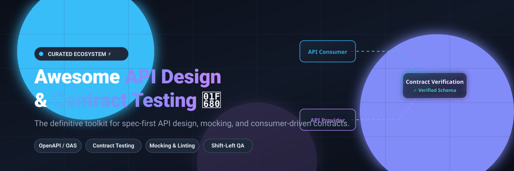

  

# Awesome API Design & Contract Testing 🚀✨

  
  
  
  
  
  

A curated, SEO-friendly collection of awesome **API design tools**, **schema linters**, **mock servers**, and **consumer-driven contract testing frameworks** for modern microservices architectures. Whether designing spec-first APIs with OpenAPI/AsyncAPI or eliminating fragile end-to-end integration tests, this guide covers both leading SaaS platforms and top-tier open-source tools. 🌐🛠️

---

## 📑 Table of Contents
- [📊 Sector Overview & Market Dynamics](#-sector-overview--market-dynamics)
- [💼 Commercial & SaaS Platforms](#-commercial--saas-platforms)
- [🌟 Top Open-Source Frameworks & Tools](#-top-open-source-frameworks--tools)
- [📈 Star History](#-star-history)
- [💖 Support & Contributing](#-support--contributing)

---

## 📊 Sector Overview & Market Dynamics

The global API management and design governance sector is valued at **$6.8B–$8.6B** (projected to reach **$36B–$53B** by 2032 at an average **20%–22% CAGR**), while the specialized API contract testing and microservices verification segment is estimated at **$1.8B–$2.8B** growing at **13.5%–14.7% CAGR**. 

Market concentration dynamics: The market exhibits **moderate fragmentation transitioning toward an ecosystem-hub model**, where broad API exploration platforms (dominated by Postman) command developer mindshare, while contract verification and schema governance remain specialized domains driven by dedicated enterprise suites (SmartBear, Pactflow) and standard-bearing open-source specifications (OpenAPI, CNCF Microcks). 🎯📈

---

## 💼 Commercial & SaaS Platforms

The table below lists the prominent SaaS and enterprise platforms supporting API design, catalog management, and contract testing, sorted by enterprise scale (valuation / annual revenue descending). 🏢💰

| Product 🏷️ | Scale (Valuation / Revenue) 📊 | Pricing (Starting Tier) 💵 | Free Tier / Trial Limits 🎁 | Description 📝 |
| :--- | :--- | :--- | :--- | :--- |
| **[Postman](https://www.postman.com/)** | **$5B–$10B** Valuation / **$100M–$500M** ARR | **$19/user/month** (Team plan, billed annually; or $9/mo for Solo plan) | **Free Forever Plan**: 1 user only (no team collaboration), unlimited collection runs, 1,000 cloud API monitoring calls/month, and ~50 Postbot AI credits/month. | Comprehensive collaborative API platform covering API design, documentation, collections, automated testing, and mock servers. |
| **[SwaggerHub](https://swagger.io/tools/swaggerhub/)** *(SmartBear)* | **$1.8B–$1.9B** Valuation / **~$150M+** ARR | **$19/user/month** (Individual plan, billed annually; Team starts at $29/user/month) | **Free Forever Plan**: 1 seat, up to 3 public API definitions, standard OpenAPI editor and documentation generation (definitions become read-only if caps are exceeded). | Cloud-based collaborative API design and documentation platform powered by OpenAPI and AsyncAPI specifications. |
| **[Pactflow](https://pactflow.io/)** *(SmartBear)* | **$1.8B–$1.9B** Valuation (Parent SmartBear) | **$115.42/month** total (Team plan, billed annually at $1,385/yr) | **Free Forever Starter Plan**: Unlimited users, maximum 2 active application contract integrations, and Bi-Directional Contract Testing capabilities. | Enterprise-grade contract testing hub built on top of Pact, featuring automated contract brokering, bi-directional verification, and CI/CD gates. |
| **[Stoplight Platform](https://stoplight.io/)** | **$20.4M** Funding / **$7.9M** Estimated ARR | **$39/month** (Starter tier for small teams, billed annually) | **Free Forever Plan**: 1 user seat, 1 active design project, basic style guide enforcement, and web-based API documentation hosting. | API-first design and documentation management suite featuring visual schema editors, linting governance, and hosted developer portals. |
| **[Specmatic Enterprise](https://specmatic.in/)** | Seed-stage Enterprise / Thoughtworks alumni | **$50/user/month** (Enterprise Tier, 50-seat minimum for first 250 seats; OSS CLI is 100% free) | **30-Day Enterprise Trial**: Full access to enterprise contract verification dashboard and Central Contract Repository for evaluation; OSS CLI free forever. | Spec-driven contract testing solution that converts OpenAPI and AsyncAPI specifications into executable contract assertions without code generation. |

---

## 🌟 Top Open-Source Frameworks & Tools

Below are the leading open-source repositories for API design, contract testing, schema linting, and mock servers, sorted by GitHub Stars_Count descending. Each repository includes a live social Stars_Badge linking to its stargazer community. 💻⭐

| Repository & Stargazers ⭐ | Open-Source Tool 🛠️ | Focus Area 🎯 | Highlights & Capabilities 🔍 |
| :--- | :--- | :--- | :--- |
|  | **[swagger-api/swagger-ui](https://github.com/swagger-api/swagger-ui)** | API Documentation & Exploration | HTML, JavaScript, and CSS assets that dynamically generate interactive, testable documentation from any OpenAPI / Swagger specification. |
|  | **[OpenAPITools/openapi-generator](https://github.com/OpenAPITools/openapi-generator)** | Code & Schema Generation | Enterprise code generator allowing generation of API client SDKs, server stubs, documentation, and configuration across 50+ languages from OpenAPI (v2, v3). |
|  | **[swagger-api/swagger-editor](https://github.com/swagger-api/swagger-editor)** | Visual API Design | Browser-based OpenAPI and AsyncAPI editor that validates specifications against standard schema rules in real time. |
|  | **[karatelabs/karate](https://github.com/karatelabs/karate)** | Automated API Testing & Mocks | Unified test automation framework combining API testing, contract verification, mock servers, and performance testing into an expressive DSL. |
|  | **[mockoon/mockoon](https://github.com/mockoon/mockoon)** | Local Mock Servers | The fastest way to run mock REST APIs locally with full route rules, JSON schema validation, templating, and CLI support. |
|  | **[stoplightio/prism](https://github.com/stoplightio/prism)** | HTTP Mocking & Contract Validation | Turns any OpenAPI 2.0/3.x or Postman Collection into a smart, realistic mock HTTP server that flags request/response schema contract violations. |
|  | **[apiaryio/dredd](https://github.com/apiaryio/dredd)** | Contract Testing CLI | Language-agnostic CLI tool for validating backend HTTP implementations against API description documents (API Blueprint and OpenAPI). |
|  | **[schemathesis/schemathesis](https://github.com/schemathesis/schemathesis)** | Property-Based Contract Testing | Property-based testing tool that automatically generates test cases from OpenAPI and GraphQL specifications to detect schema edge cases and server crashes. |
|  | **[stoplightio/spectral](https://github.com/stoplightio/spectral)** | Schema & Style Guide Linting | Flexible JSON/YAML linter for enforcing API design guidelines, style guides, and structural consistency across OpenAPI v2/v3, Arazzo, and AsyncAPI. |
|  | **[microcks/microcks](https://github.com/microcks/microcks)** | Cloud-Native Mocking & Testing | CNCF-incubating Kubernetes-native platform for turning OpenAPI, AsyncAPI, and gRPC contracts into mock endpoints and automated CI/CD verification suites. |
|  | **[pact-foundation/pact-js](https://github.com/pact-foundation/pact-js)** | Consumer-Driven Contract Testing | Official JavaScript/TypeScript implementation of the Pact contract testing framework for HTTP and asynchronous event-driven architectures. |
|  | **[opticdev/optic](https://github.com/opticdev/optic)** | API Diffing & Breaking Change Prevention | OpenAPI git-aware diffing engine and linter that detects breaking changes, enforces style guidelines, and automates schema PR reviews. |
|  | **[pact-foundation/pact-jvm](https://github.com/pact-foundation/pact-jvm)** | JVM Contract Testing | JVM implementation of Pact (Java, Kotlin, Scala, Groovy) providing consumer contract generation and provider interaction verification. |
|  | **[ApicurioArchive/apicurio-studio](https://github.com/ApicurioArchive/apicurio-studio)** | Collaborative Spec Design | Open-source visual API design studio for collaboratively modeling and publishing OpenAPI, AsyncAPI, and Apache Avro specifications. |
|  | **[pact-foundation/pact-net](https://github.com/pact-foundation/pact-net)** | .NET Contract Testing | .NET implementation of the Pact specification enabling consumer-driven contracts and provider interaction verification across C# and F# services. |
|  | **[pact-foundation/pact_broker](https://github.com/pact-foundation/pact_broker)** | Contract Repository & CI Matrix | Open-source server application that stores and coordinates consumer-driven contracts, verifies compatibility matrices, and automates safe CI/CD deployments. |
|  | **[spring-attic/spring-cloud-contract](https://github.com/spring-attic/spring-cloud-contract)** | Spring Boot Contract Testing | Consumer Driven Contract (CDC) framework for Spring microservices, generating WireMock stubs and REST Docs contract validations. |
|  | **[specmatic/specmatic](https://github.com/specmatic/specmatic)** | Spec-Driven Contract Testing | Turn OpenAPI specifications into executable contract tests without writing boilerplate test scripts; isolates microservices via contract-backed virtual services. |

---

## 📈 Star History

---

## 💖 Support & Contributing

Thank you for visiting **Awesome API Design & Contract Testing**! 🌟

If you found this curated list helpful in your API design or microservice testing journey:
- ⭐ **Star** this repository to show your appreciation and help other engineers discover it.
- 🍴 **Fork** and contribute any missing frameworks, tools, or updates via pull requests.
- 📢 **Share** this guide with your developer community and engineering teams.
- ☕ **Support the maintainer**: Consider buying a coffee or becoming a sponsor via the [GitHub Sponsor Dashboard](https://github.com/sponsors/ishandutta2007).

Your support keeps this ecosystem up-to-date and continuously expanding! 🚀🎉
